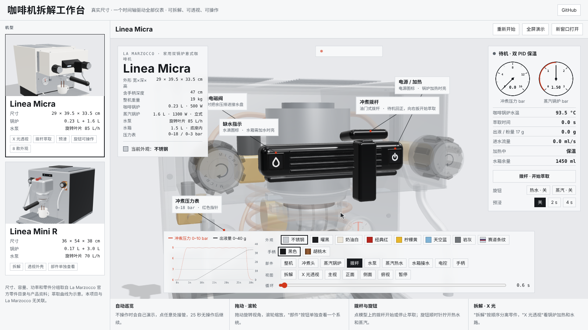
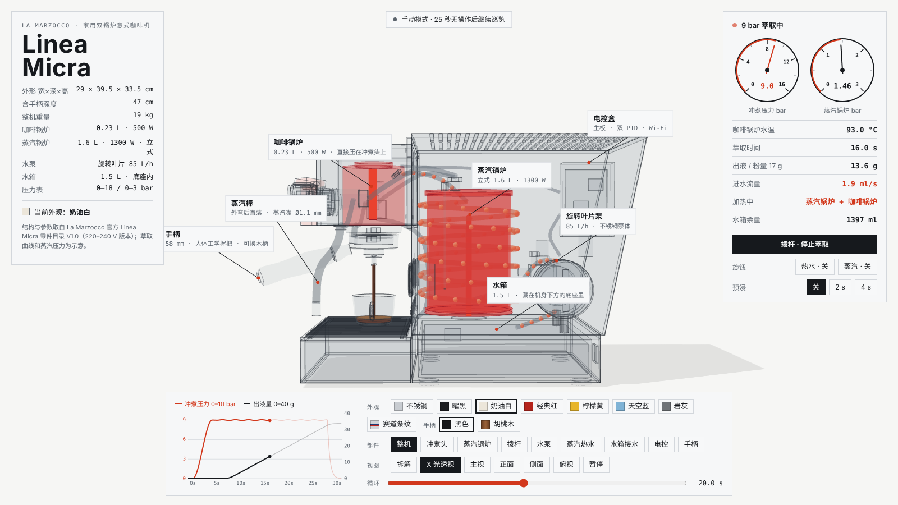
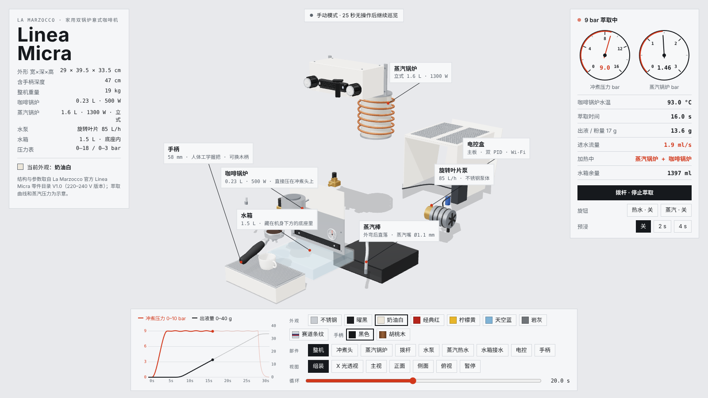
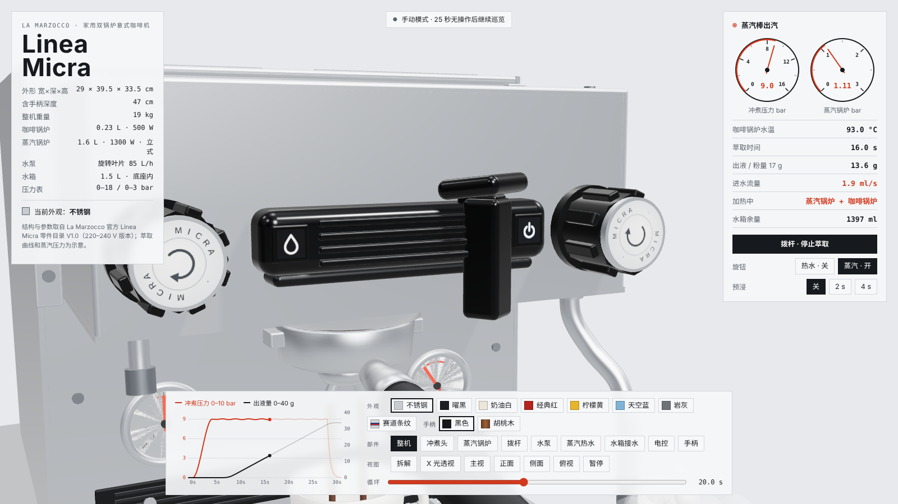
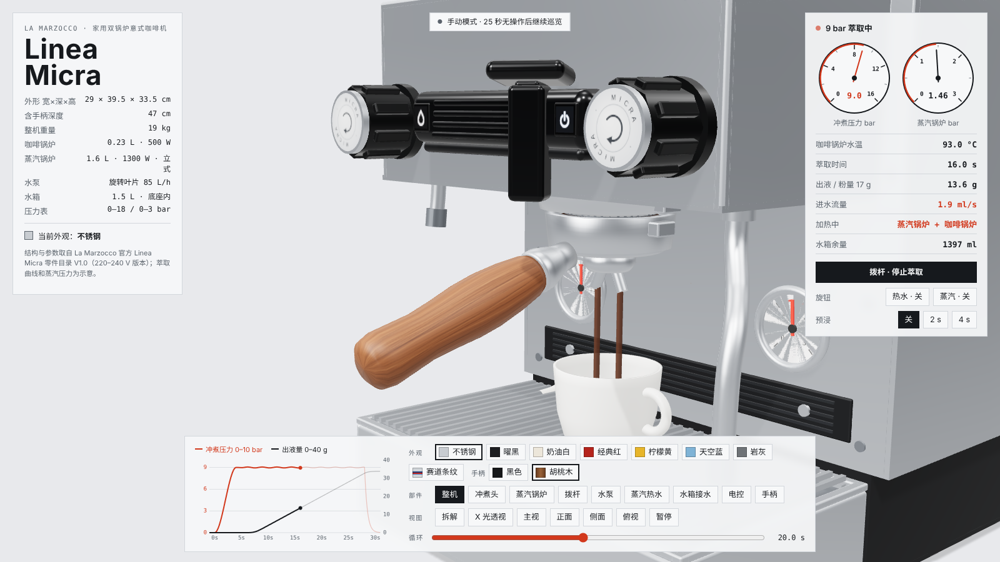
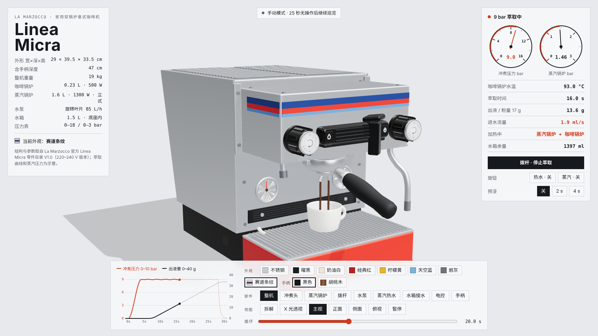
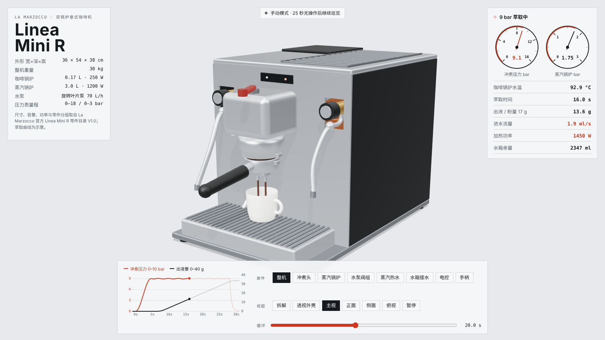
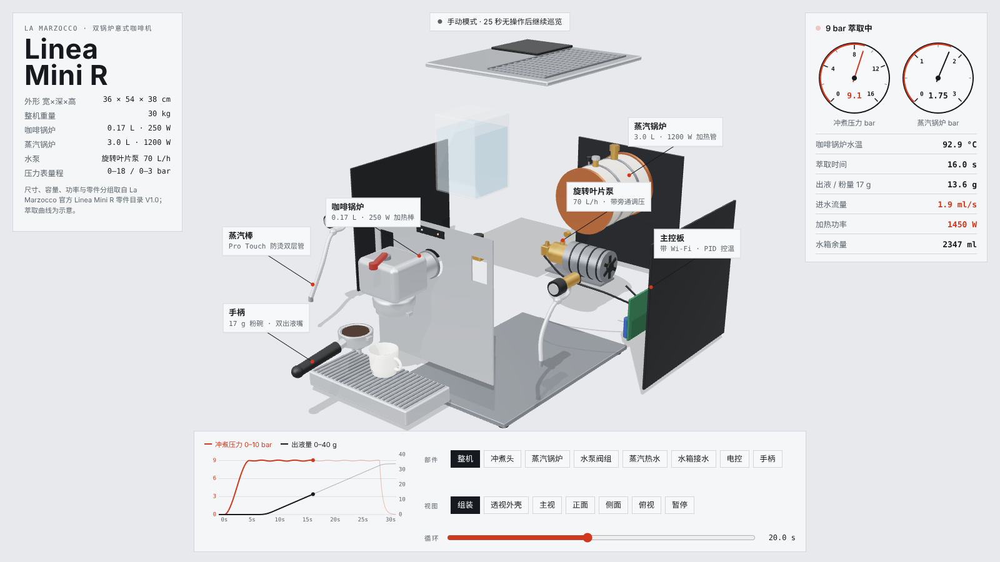

# 咖啡机拆解工作台 · Coffee Teardown Studio

可拆解、可透视、可操作的意式咖啡机三维模拟器，纯前端、单页 HTML，打开即用。

目前收录两台 La Marzocco 家用机：**Linea Micra** 和 **Linea Mini R**。



## 在线演示

开启 GitHub Pages 后访问：`https://tgchtggn29-bit.github.io/coffee-teardown-studio/`

- 工作台：`index.html`，左侧选机型，右侧直接操作
- 单独打开：`sims/linea-micra.html`、`sims/linea-mini-r.html`

## 能做什么

| 功能 | 说明 |
|---|---|
| 实时运转 | 萃取 → 关阀泄压 → 蒸汽 → 自动补水，44 秒一个循环 |
| 仪表同步 | 压力表、温度、出液量、萃取曲线和三维模型读同一套数据，不会对不上 |
| 拨杆萃取 | 油门式拨杆，点模型上的拨杆或右侧按钮开始/停止萃取，待机回正，向右扳开始；两端水滴（缺水）和电源（加热）图标会亮 |
| 预浸 | 关 / 2 秒 / 4 秒，压力曲线先停在约 2.5 bar 再升到 9 bar |
| 热水 / 蒸汽旋钮 | 八棱握圈 + MICRA 端盖，顺时针拧开，热水嘴出水、蒸汽棒喷汽，蒸汽压力表随之回落 |
| X 光透视 | 半透明玻璃加轮廓线，锅炉加热时显示红色，水路有流动红点 |
| 拆解 | 按真实拆装顺序分离零件，路径经过检查不穿模 |
| 部件 | 单独查看冲煮头、蒸汽锅炉、拨杆、水泵、蒸汽热水、水箱接水、电控、手柄 |
| 换外观 | Linea Micra 有 8 款：不锈钢、曜黑、奶油白、经典红、柠檬黄、天空蓝、岩灰、赛道条纹；手柄可选黑色或胡桃木 |
| 自动巡览 | 不操作时自己演示，点任意处接管，25 秒无操作后继续 |





| 拨杆与旋钮 | 胡桃木手柄 |
|---|---|
|  |  |



| Linea Mini R | Linea Mini R 拆解 |
|---|---|
|  |  |

## 本地运行

页面用 ES Module 加载 three.js，需要通过 HTTP 打开（直接双击 HTML 会被浏览器拦截）：

```bash
git clone https://github.com/tgchtggn29-bit/coffee-teardown-studio.git
cd coffee-teardown-studio
python3 -m http.server 8000
# 浏览器打开 http://localhost:8000
```

three.js 已放在 `vendor/three/`，不依赖外部 CDN，断网也能用（只有字体会回退到系统字体）。

## 开启 GitHub Pages

仓库 Settings → Pages → Build and deployment，Source 选 **Deploy from a branch**，Branch 选 `main` / `/ (root)`，保存后一两分钟即可访问。

## 目录

```
index.html                 工作台
sims/linea-micra.html      Linea Micra 模拟器
sims/linea-mini-r.html     Linea Mini R 模拟器
vendor/three/              three.js r170 与用到的三个扩展（MIT）
docs/screenshots/          截图
```

## 数据来源

- Linea Micra：La Marzocco 官方零件目录 V1.0、产品册与产品资料（尺寸、锅炉容量与功率、水泵 85 L/h、压力表量程、零件名称与分组）
- Linea Mini R：La Marzocco 官方 Linea Mini R 零件目录 V1.0
- 外观按实拍照片与官方侧剖图还原；拨杆待机回正、旋钮顺时针开启按实际操作视频修正
- 萃取曲线、蒸汽锅炉工作压力为示意值；零件的具体摆放位置部分为推断

## 致谢

建模与演示方式参考了开源 Claude Code 技能 [teardown](https://github.com/elvarofficial/teardown)（MIT）的方法：真实尺寸作唯一数据源、一个时间输入驱动全部、做功部件高亮、自动巡览。

## 声明

本项目为个人学习与展示用途，与 La Marzocco 无任何关联。La Marzocco、Linea Micra、Linea Mini 为其所有者的商标。

## 许可

MIT
